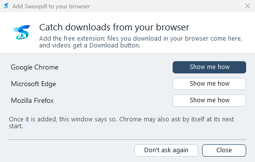
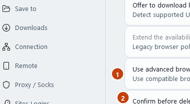
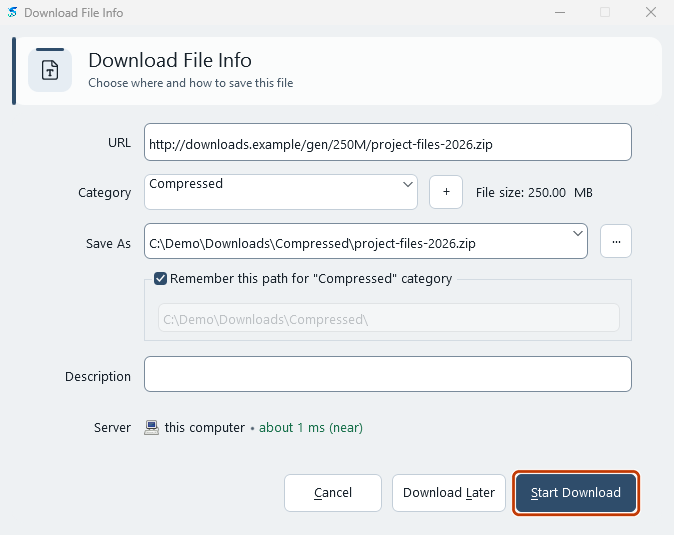
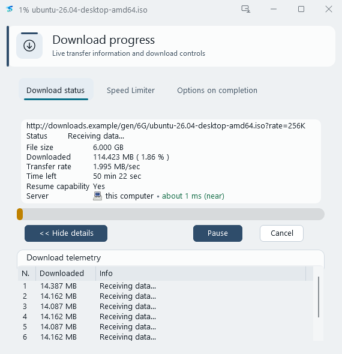
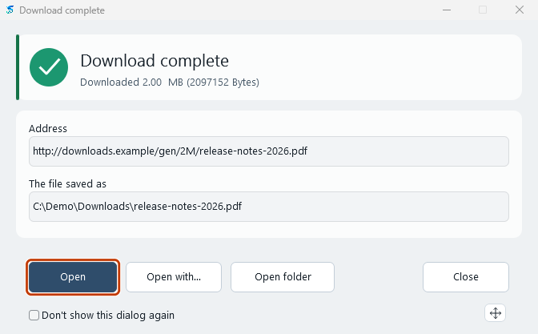
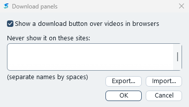
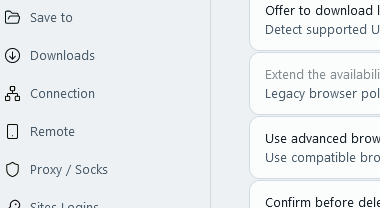

# Browser integration

[← Back to docs index](README.md)

The Swoopdl extension sends supported browser downloads to Swoopdl with their referrer, cookies, and User-Agent. Keep browser integration enabled in Swoopdl's Options and approve the extension in your browser.

The extension files are built from this repository and bundled with Windows, Linux, and macOS packages. Setup uses local files; it does not download an extension or open a browser store. It does not silently approve browser permissions or change browser policies.

The setup helpers detect Chrome, Edge, Brave, and Firefox. Chromium-family browsers that support **Load unpacked** can use the same Chromium folder manually. Browser forks and sandboxed packages may need additional native messaging support; see [connection troubleshooting](browser-help.md#linux-sandbox).

## Set it up

There are two parts: register the bundled native messaging helper, then load the extension in your browser. Use the instructions for your platform below. Keep Swoopdl and its extension folder in the same permanent location after setup.

**Browser capture is off by default.** After setup, enable **Options → General → Use advanced browser integration** and tick the browsers to capture from. Swoopdl does not automatically show the extension installation window at startup in the current implementation.


*Development connection window; use the bundled local setup helper for installation.*

### Windows

1. Run the Swoopdl installer and keep **Set up browser integration** selected.
2. On the final page, select **Set up the bundled browser extension**. You can run **Swoopdl Browser Setup** from the Start menu later.
3. The helper chooses an installed browser and shows the local extension path. Complete the Chromium or Firefox steps below.

For a per-user installation, the files are in `%LOCALAPPDATA%\Programs\Swoopdl\extension`. An all-users installation normally uses `C:\Program Files\Swoopdl\extension`.

To choose a browser explicitly, run the bundled helper from PowerShell:

```powershell
& "$env:LOCALAPPDATA\Programs\Swoopdl\extension\install-local.ps1" -Browser Edge
```

Supported choices are `Auto`, `Chrome`, `Edge`, `Brave`, `Firefox`, and `Both` (Chrome and Firefox).

### Linux

For a .deb or .rpm installation, choose **Swoopdl Browser Setup** from the applications menu, or run:

```sh
sh /usr/share/swoopdl/extension/install-local.sh
```

For the extracted tar.gz package, run `sh extension/install-local.sh` from its folder. The helper registers the adjacent native messaging host for your user, then opens the browser's local setup page. Use `--browser chromium` or `--browser firefox` to select a family.

An AppImage mount is temporary. Extract the AppImage into a permanent folder before using local browser setup:

```sh
./Swoopdl-<version>-linux-x86_64.AppImage --appimage-extract
sh squashfs-root/usr/share/swoopdl/extension/install-local.sh
```

Replace `<version>` with your package version. Keep the extracted folder in place. Install a .deb or .rpm instead if you prefer a fixed system location. Do not run the user setup helper with `sudo`.

### macOS

1. Open the disk image and copy **Swoopdl.app** to Applications.
2. Double-click **Set up browser extension.command** in the disk image. It uses the installed app, rather than the temporary disk image path.
3. Approve the local extension in your browser as described below.

The files are inside `Swoopdl.app/Contents/Resources/extension`. The same setup launcher is bundled there. Keep the app in Applications after registering its native messaging host.

### Firefox

The bundled `sdl-firefox.xpi` is an unsigned development package:

1. Open `about:debugging#/runtime/this-firefox` in Firefox.
2. Choose **Load Temporary Add-on** and select the bundled `sdl-firefox.xpi`.
3. Check the extension is enabled, then try a download.

Firefox removes temporary add-ons when it closes. Permanent installation in standard Firefox requires a Mozilla-signed XPI. If a signed Swoopdl XPI is supplied, choose **Install Add-on From File** in `about:addons` and select that local file. Mozilla signing does not require a public store listing. Do not disable signature checks to install the unsigned package.

### Chrome, Edge, Brave, Opera and Vivaldi

1. Open your browser's extensions page, such as `chrome://extensions`, `edge://extensions`, or `brave://extensions`.
2. Enable **Developer mode**.
3. Select **Load unpacked** and choose the bundled `chromium` folder, not a ZIP file.
4. Keep **Swoopdl** enabled. Pin its toolbar button if you want quick access to connection status.

The setup helper prints the correct local folder. On Windows, it is the `extension\chromium` folder inside your installation. On Linux or macOS, use the `chromium` folder next to the setup helper. Organization policies may prevent developer extensions; ask your administrator rather than changing browser policies.

### Safari (macOS)

Safari integration is not included in the current Chromium/Firefox packages. Use a supported browser or paste download URLs into Swoopdl. Safari extension source remains available for development; these installation steps do not enable it.

### From the plain zip

The Windows plain and portable ZIP packages include an `extension` folder. Run its `install-local.ps1` helper to register the adjacent native host and load the extension locally. Registration is explicit and writes native messaging entries for your Windows account, even for a portable copy.

To unregister the helper, run `swoopdl-nmhost.exe --unregister` from the same application folder. If you want a registry-free portable copy, skip browser setup and use **Add URL**, the clipboard, or the drop target.

The application's integration diagnostic still flags portable mode. Manual host registration is not proof that the portable copy has the same support status as an installed copy; use the installed package for the normal browser integration path.

### Updating the extension

Install the matching Swoopdl package and use its bundled extension files. Reload the unpacked Chromium extension from the browser's extensions page after updating. For an unsigned Firefox package, load the matching XPI again after restarting Firefox. Bundled extensions do not receive automatic browser-store updates.

## What it takes

When you click a download, the extension checks SDL's Options:

- **Options → General → Use advanced browser integration** must be on. Turn it off to send nothing to SDL.
- **Options → General → Capture downloads from the following browsers** must have your browser ticked.
- **Options → File types → Automatically start downloading the following file types** must list the file's type. The list starts with the usual ones: ZIP, RAR, 7Z, EXE, MSI, ISO, DMG, DEB, RPM, APPIMAGE, MP3, MP4, MKV, WEBM, PDF, AI models such as GGUF and SAFETENSORS, 3D files such as GLB and STL, and many more. Anything else can be added to the list.
- **Options → File types → Don't start downloading automatically from the following sites** must not list the site. Names are separated by spaces, and `*` matches any part, as in `*.update.microsoft.com`. **Edit list ...** below it lists whole addresses to leave alone, one per line (`https://example.com/private/*`).
- **Options → File types → Don't take files smaller than** leaves small files (a receipt, an icon) to the browser. 0 takes any size.
- The extension must be allowed to read the site. When you limit it to some sites (or **On click**), it can't pass your sign-in on, so it leaves those sites' downloads to the browser.


*1 must be on, and 2 your browser ticked.*

When the browser keeps a download, the extension's button says which of these left it there, with the file's name, and SDL's log has a line for each one (`logs\sdl.log` in [SDL's data folder](crash-reports.md#where-reports-are-kept)).

Both the address you clicked and the one its redirects led to are checked, so a site you excluded stays excluded even when it sends you to another server. Everything else stays with the browser. Changes in Options reach the browser within a minute; you don't need to restart it.

When SDL takes a download, it gets the browser's file name, size and type with it, so **Download File Info** shows them at once without asking the server again. A download from a form (a button that posts and gets a file back) is posted again by SDL with the form's data; a form that sends a file stays with the browser.

When SDL takes a download, the browser's own copy is cancelled and removed from the browser's download list. In Firefox and the browsers built on it (Waterfox, Zen, LibreWolf), SDL takes it as soon as the server answers, before the browser asks *What should … do with this file?*: for a file SDL takes, that question never shows (Waterfox asks it for every new type of file). Files SDL doesn't take get the question as before. **Download File Info** opens in SDL (unless you turned it off in **Options → Downloads**). Cancelling there doesn't hand the download back to the browser.

<!-- steps -->

1. 
   *Click a download link in the browser: Download File Info opens in SDL.*
2. 
   *Start Download: the progress window shows it coming in.*
3. 
   *Download complete: Open the file, or Open folder.*

Downloads from a private window use that window's cookies, never the normal ones, and aren't kept in SDL's list after it closes.

Files SDL downloads from the browser are marked as coming from the internet, as the browser marks its own: Windows checks a program with SmartScreen before it runs and Office opens a document in Protected View.

## Files the browser would open

A PDF, a song or a video that the browser would show or play itself goes to SDL too, when its type is in **Options → File types** (not on the excluded sites). To turn this off, untick **Also take files the browser would open** in **Options → General → Keys...**. This needs a Chromium browser (Chrome, Edge, Brave, Opera, Vivaldi) version 128 or later, or Firefox.

## The toolbar button

The extension's button shows whether the browser reaches SDL. A red **!** means it doesn't; click the button to see why, and **How to fix it** opens the matching section of [The browser and SDL aren't connected](browser-help.md). The button also:

- **Take downloads from this browser**: untick it to pause, and every download stays with the browser until you tick it again.
- **Never take downloads from** the current site: adds it to SDL's excluded sites.
- **Open Swoopdl** and **Options...**.
- **Media on this page**: what the page has loaded that SDL can download (see below).

## A VPN or proxy extension

A VPN or proxy extension is a proxy for the browser only. Switch on **Send downloads through this
browser's proxy or VPN extension** in the extension's toolbar popup (it's off as installed), and
SDL downloads what it takes from the browser through the same proxy (with **Options → Proxy /
Socks → Use proxy/socks from a browser's request**, on by default; see
[Options](options.md#proxy--socks)). Switched off, the extension reads nothing of the browser's
proxy.

- **Firefox** asks you once, at the switch, to allow the extension to read the browser's proxy;
  switching it off takes that permission back. SDL gets the proxy the browser's own request for
  the file took, including the ones a VPN extension picks for each request.
- **Chrome, Edge, Brave, Opera and Vivaldi** can't ask for that permission at the switch, so the
  extension has it from the install (Chrome counts it under the access to every site the extension
  already asks for, so it adds no line to the install prompt and the update asks for nothing new).
  The switch asks nothing. SDL gets the browser's effective proxy, whoever set it (a VPN or proxy
  extension, a policy, the command line): a fixed server for the download's scheme (`http`,
  `https`, `socks4`, `socks5`), unless the address is on its bypass list, or its proxy auto-config
  script (by its address or inline). With no proxy, or the system's, nothing is sent and SDL goes
  by its own Options. A QUIC proxy can't be shared.

In both, the proxy's login is never read: a proxy that asks for the VPN extension's own login
can't be shared, and the download says so rather than going without it.

## Media on this page

Some pages play a video without a link to it, and some players hide it from the download button
too. The toolbar button lists what the page has loaded, so you can still save it:

- **Streams**: HLS (`.m3u8`) and DASH (`.mpd`), the way most sites play long videos. Each stream
  is listed once, however many qualities its player switched between, with its qualities (`1080p ·
  720p`) and its length when the extension can read them. A stream whose address doesn't end in
  `.m3u8` or `.mpd`, served as plain text, is found too: when you open the list (or press the
  download button over its player) and the player plays a stream, the extension reads the first
  few kilobytes of what that player fetched to recognise it. Nothing is read until you ask.
- **Video and sound files** the page played (MP4, WebM, MP3 and the like), with their size and,
  for a video, its picture size.

Start the video first: the list fills as the page loads things, and it's emptied when the tab goes
to another page. With **Prefix media file names with the page title** on, a file from the list is
named after the page, then its own name (`The page - clip.mp4`). Click **Download** beside one: a stream opens SDL's **Download video from a page**
window, which reads its qualities (yt-dlp does the work); a file goes to SDL's list like any other
download. Your cookies for its server, the page as the referrer and your browser's User-Agent go
with it, as they do for a link you click.

Pieces of a stream (its segments) are never listed. A copy-protected stream (DRM: Widevine,
PlayReady, FairPlay, as most paid streaming services use) is listed as **Protected**, with no
**Download** button: no tool may break that protection, and SDL doesn't try.

This needs nothing more from you: the extension already sees what the browser downloads in order
to hand downloads over. What it notes stays in the browser's memory and is forgotten when the
browser closes.

## Right-click: Download with Swoopdl

Right-click a link, a video, a sound or a picture and choose **Download with Swoopdl**. SDL downloads it whatever its type: you asked for it, so the file types list and the excluded sites don't apply here (they only decide which downloads SDL takes over by itself). A video that plays as a stream goes to the **Download video** window with the stream its player loaded (HLS or DASH), as the [button over videos](#the-download-button-over-videos) sends it, with your cookies for the stream's server and the page as the referrer.

Select part of a page and right-click it for **Download selected links with Swoopdl**, or right-click the page for **Download all links with Swoopdl**: the links open in **[Link grabber](link-grabber.md)**, sorted into packages, where you tick the ones you want.

If SDL can't be reached when you choose one of these, the help page opens at the section that explains why.

## The download button over videos


Point at a video on a web page and a small **Download video** button appears at its edge. Click it and SDL's **Download video from a page** window opens and looks up the qualities it can download. It takes the video you clicked: its own file when it plays one, or the stream the player loaded (HLS or DASH), else the page. When the button can't tell which one you mean, the toolbar button's [Media on this page](#media-on-this-page) lists them all. Embedded players work too, and your sign-in for the site, the page that embeds the player and your browser's User-Agent go with it, so videos for members, or that play only on the site that embeds them, can be downloaded. Sound players get the button too.

It stays out of the way: it shows only while you point at a video (or the player has the keyboard's focus; **Tab** then moves to the button), fades when the pointer rests, and leaves out small videos and short muted loops (animated pictures, backgrounds). In fullscreen it follows the video when the player allows it. On a copy-protected video (DRM) it says that the video can't be saved.

- **Move it**: drag it anywhere along the video's edge; it snaps to the nearest edge and stays there on that site.
- **Its menu** (the arrow next to it): **Hide on this video**, **Never on** the site (SDL remembers the site), and **Button settings...**, which opens SDL's Options.
- **Turn it off, or see the sites it stays off**: **Options → General → Customize SDL Download panels in browsers → Edit...**.


*Options → General → Edit...: turn the button off, or list sites it never shows on.*

The button follows the rest of the integration: it doesn't show when **Use advanced browser integration** is off or the browser is unticked.

## Keys to force or prevent capture

Hold **Alt** while clicking a link to let the browser download it instead of SDL. In Firefox, Alt+click saves a link only when its `browser.altClickSave` setting is on (in `about:config`); otherwise right-click the link and choose **Save Link As...**, which the browser keeps. **Options → General → Keys...** says so, and holds **Also take files the browser would open**.

To keep a site's downloads in the browser for good, use the toolbar button's **Never take downloads from**, or add the site to **Don't start downloading automatically from the following sites**. To keep a file type in the browser, take it off the file types list.

## When SDL isn't running

You don't need to start SDL first. When the browser hands over a download and SDL isn't running, the helper starts it and passes the download on.

If SDL can't be reached at all (it was uninstalled, or the helper isn't registered), the download stays with the browser, so nothing is lost, and the toolbar button shows a red **!**. See [The browser and SDL aren't connected](browser-help.md), or run **Options → General → Test browser integration...**.


*Test browser integration... says whether the browser reaches SDL.*

## Next steps

- [Tutorial: catch downloads from your browser →](guide-catch-browser-downloads.md)
- [Change which file types SDL takes →](options.md)
- [If the browser doesn't hand downloads over →](troubleshooting.md)
