# Getting started

[← Back to docs index](README.md)

SDL runs on 64-bit Windows 10 and Windows 11, and on 64-bit Linux: see [On Linux](#on-linux).
Builds for macOS are new and still experimental: see [On a Mac](#on-a-mac).

## Choose a download

Use packages from the Swoopdl source provided by its maintainer. Do not install another project's releases. Windows packages have these names:

| File | What it is |
|---|---|
| `Swoopdl-<version>-setup.exe` | The installer. Pick this one unless you have a reason not to. It can set up browser integration and open `.torrent` files and magnet links with SDL. |
| `Swoopdl-<version>-portable.zip` | A portable copy. The download list and settings stay in a `data` folder next to the program, and normal startup does not register browser integration. Running the bundled extension setup explicitly writes user registry entries. See [Portable mode](portable.md). |
| `Swoopdl-<version>-x64.zip` | The same programs without an installer. It keeps its data in `%APPDATA%\swoopdl`, like an installed copy. |

### On Linux

SDL runs on 64-bit Linux with a desktop session. It is tested on Ubuntu 24.04, Debian 12 and
Fedora, with GNOME, KDE Plasma, Xfce and Cinnamon, on X11 and in Wayland sessions. Pick one
of these files (up to version 0.2.4, their names end in `-experimental`, as in
`...-linux-x86_64-experimental.deb`):

| File | What it is |
|---|---|
| `...-linux-x86_64.deb` | For Ubuntu, Debian, Mint and Pop!_OS: `sudo apt install ./<file>.deb`. It brings the libraries SDL needs. |
| `...-linux-x86_64.rpm` | For Fedora, openSUSE and RHEL: `sudo dnf install ./<file>.rpm`. It brings the libraries SDL needs. |
| `...-linux-x86_64.AppImage` | Runs on most distributions: make it executable (`chmod +x`) and run it. It updates itself in place (**Help → Check for updates**). |
| `...-linux-x86_64.tar.gz` | The plain programs, for any distribution. |

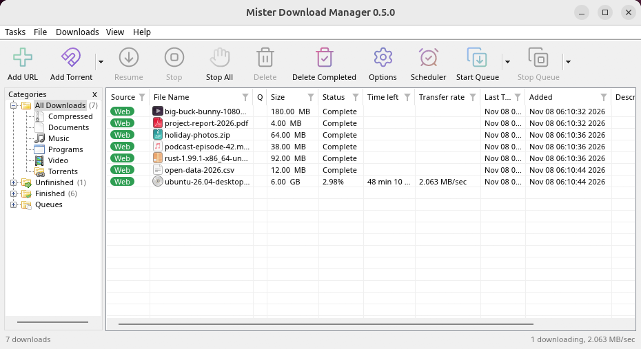
*SDL on Ubuntu's GNOME desktop, with the desktop's own file icons.*

For browser integration, run **Swoopdl Browser Setup** from the applications menu after installing a .deb/.rpm, or use the extracted package's `extension/install-local.sh`. AppImage users must extract to a permanent folder first. See [Browser integration](browser-integration.md#linux) and [sandboxed browser limits](browser-help.md#linux-sandbox).

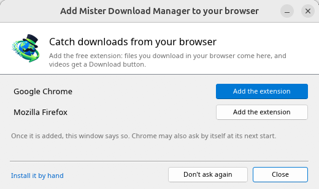
*Development browser connection window; use the local setup helper for installation.*

In a Wayland session the windows go through XWayland (below). Not there yet on Linux: screen
readers (Orca) don't read SDL's windows; browsers installed as a Flatpak can't reach SDL (Firefox
from Flathub may, through the desktop as the Snap does, but that isn't checked yet); and **View →
Draw with → Vulkan** is a choice, OpenGL stays the default.

In a Wayland session (GNOME, KDE Plasma and others), SDL's windows run through XWayland when it is there: Wayland doesn't let a program place its own windows, so SDL's menus and drop-down lists would open in the middle of the screen. To run on Wayland itself anyway, start it with `SDL_WAYLAND=1 swoopdl`. If the system lacks a library X11 windows need (such as libxkbcommon-x11, which the .deb and .rpm bring but the AppImage and the tar.gz can't), SDL opens on Wayland instead; with no window system it can use, it names what's missing and the command that installs it.

The windows are the ones described in this help, with the desktop's fonts, file icons and title
bars:

<!-- pictures -->

- 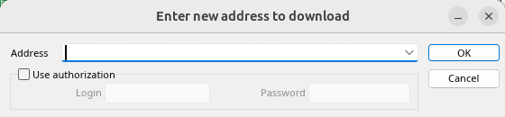
  *Add URL.*
- 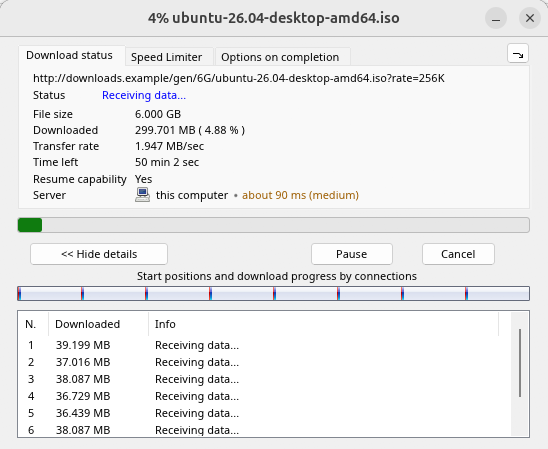
  *A download's progress.*
- 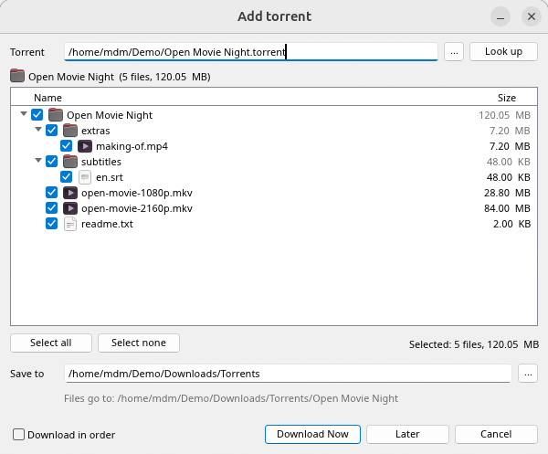
  *Add torrent.*
- 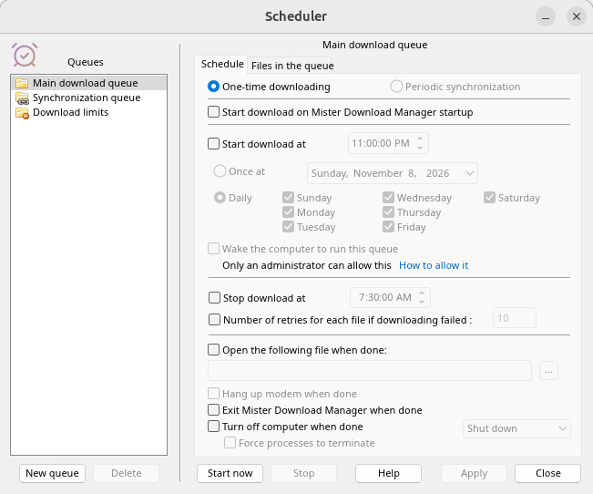
  *The Scheduler.*
- 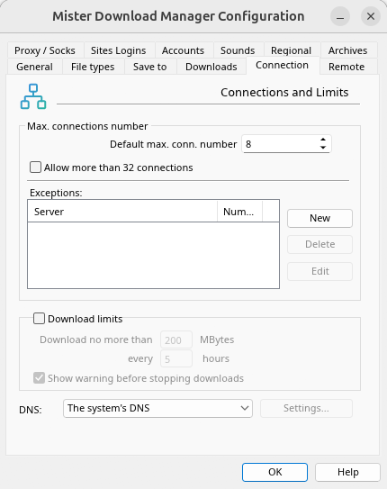
  *Options.*

And on the other desktops it was checked on:

<!-- pictures -->

- 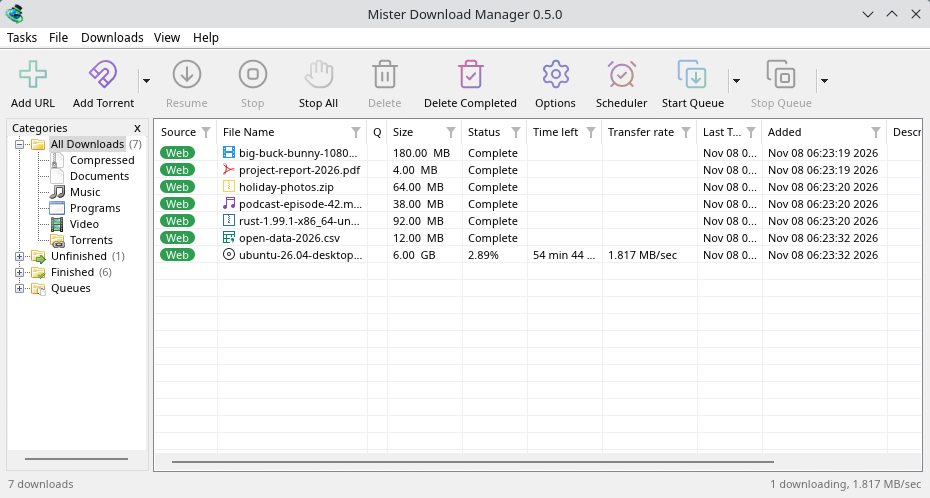
  *KDE Plasma.*
- 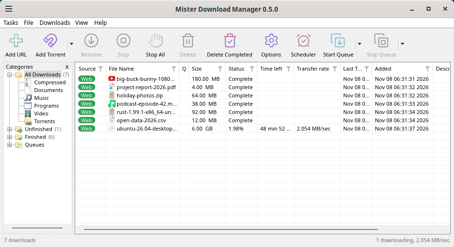
  *Cinnamon.*
- 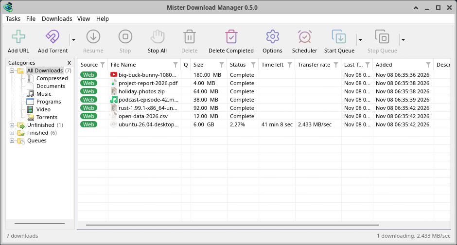
  *Xfce.*

#### Uninstall on Linux {#uninstall-linux}

`sudo apt remove swoopdl` (or `sudo dnf remove swoopdl`) removes the
programs, and the small files that tell your browsers where SDL's helper is: the .deb and .rpm
install those for everyone (in `/etc` and `/usr/lib`), for Chrome, Chromium, Edge, Brave, Vivaldi
and Firefox (the Snap too), so SDL doesn't write them in your home folder. For the AppImage or the
tar.gz, delete the file or the folder.

What SDL keeps in your home folder stays, as with any package: your list and settings
(`~/.local/share/swoopdl`), the AppImage's and the tar.gz's browser files, and
those of the browsers that read them only there (Opera, Helium, Thorium, and Firefox's forks:
Zen, LibreWolf, Floorp, Waterfox). A package can't remove those: it never touches
home folders. Without SDL they lead nowhere, so the extension says it can't reach SDL. To remove
them as well, run this as each user who used SDL, **before** uninstalling:

```sh
swoopdl-nmhost --unregister
```

(From the AppImage: `~/.local/share/swoopdl/browser-host/swoopdl-nmhost --unregister`.)
Already uninstalled? This removes the same files:

```sh
find ~/.mozilla ~/.librewolf ~/.config -name com.swoopdl.host.json -delete 2>/dev/null
```

### On a Mac

The macOS builds are fresh and still experimental: we haven't tried them on a Mac ourselves yet,
so you'd be among the first. Please
tell us how it went through this Swoopdl repository's Issues page, good or bad.

| File | What it is |
|---|---|
| `...-macos-arm64-experimental.dmg` | For a Mac with Apple Silicon (M1 or later: **Apple menu → About This Mac** shows a *Chip*). Open it and drag Swoopdl to Applications. macOS asks before its first start, because the app isn't notarized by Apple: right-click it and choose **Open** (on macOS 15 and later: **System Settings → Privacy & Security → Open Anyway**). |
| `...-macos-x86_64-experimental.dmg` | The same, for a Mac with an Intel processor (About This Mac shows a *Processor*). |

For browser integration, copy Swoopdl.app to Applications, then run **Set up browser extension.command** from the disk image. Approve the bundled Chromium or Firefox extension as described in [Browser integration](browser-integration.md#macos). Safari integration is not included in this setup.

## Install with the setup

1. Run `Swoopdl-<version>-setup.exe`.
2. Choose the language. Windows' display language is already selected. The setup offers every language SDL has, and SDL starts in the one you pick.
3. Choose whether to install for you only or for everyone on the computer. For you only needs no administrator rights and goes to `%LOCALAPPDATA%\Programs\Swoopdl`. For everyone goes to `Program Files`.
4. Pick what the setup should do:
   - **Set up browser integration (Chrome, Edge, Brave, Firefox)**
   - **Open .torrent files and magnet links with Swoopdl**
   - **Start Swoopdl when Windows starts**
   - **Create a desktop shortcut** (off unless you tick it)
5. Click **Install**, then **Finish** to start SDL.

If SDL is already running, the setup asks it to save and close first. To update, use **Help → Check for updates → Update now**, or run the setup of the new version; your list and settings stay.

Browser integration needs browser approval after local setup. Run **Swoopdl Browser Setup** from the Start menu or the installer's final page, then load the bundled Chromium folder or Firefox XPI. No extension download is required. See [Browser integration](browser-integration.md).

Browser capture is off by default: enable **Options → General → Use advanced browser integration** and select your browser after setup.

### Uninstall

Uninstall SDL from Windows **Settings → Apps**. The uninstaller asks whether to delete your download list and settings too. Your downloaded files are never touched.

## Use a zip copy

1. Unzip the file to a folder you can write to (not straight into `Program Files`).
2. Run `swoopdl.exe`.

The zips hold the same programs as the setup: the app, `swoopdl-cli.exe` (downloads from the command line; see [Command line and automation](command-line.md)) and the `extension` folder.

## First start and the language

- **Installed with the setup:** SDL starts in the language you chose in the setup.
- **Otherwise:** SDL shows the list of languages, each with its flag and its own name. Pick yours.

You can change it at any time in **View → Language**. More in [Languages](languages.md).

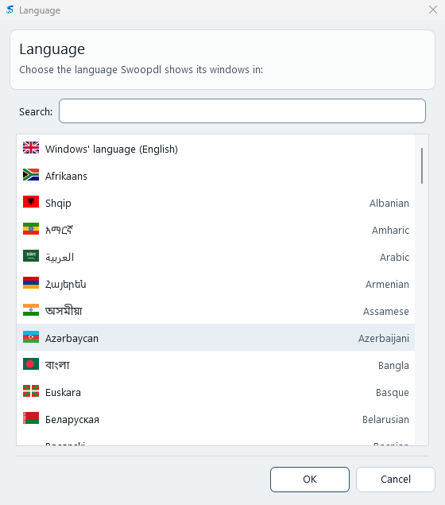
*Pick your language. View → Language changes it later.*

## The video helpers

Next, SDL offers its two free video helpers: **yt-dlp**, which finds the video on a page, and
**ffmpeg**, which joins its picture and sound. Click **Yes, download them (recommended)** and they
download in the background, about 100 MB, once. **Not now** leaves them for later: the video
window offers them when you first need them. More in [Videos](video.md).

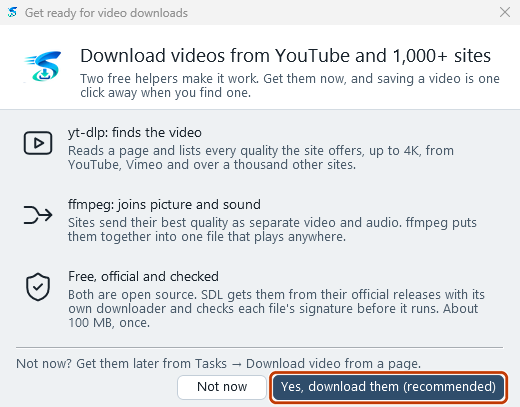
*Yes downloads both helpers in the background, once.*

## The main window

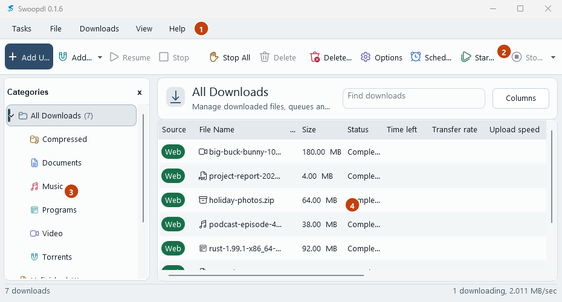
*1 the menu bar, 2 the toolbar, 3 the categories, 4 the download list.*

From top to bottom:

- **Menu bar.**
  - **Tasks** — add downloads, torrents, magnet links, batch downloads and videos from a page; **Torrent settings**; **Link grabber**; **RSS feeds**; show the drop target; import and export the list; exit.
  - **File** — the selected download: **Stop Download**, **Remove**, **Download Now**, **Redownload**.
  - **Downloads** — **Pause All**, **Stop All**, **Delete All Completed**, **Find**, the **Scheduler**, queues, the **Speed Limiter** and **Options**.
  - **View** — show or hide the categories, sort the list (**Arrange files**), **Dark Mode support**, **Always dark**, **Theme**, **Interface size** (every window larger, 100 % to 200 %; **Ctrl +**, **Ctrl −** and **Ctrl 0** too), **Draw with** (OpenGL, or Direct3D on Windows, Vulkan on Linux, Metal on macOS) and **Language**.
  - **Help** — help pages and tutorials (on the website, in your language when it has it), **Keyboard shortcuts**, **Report a problem**, **Check for updates**, **About**, **Tell a friend** and **Support SDL** (its creator's GitHub Sponsors page: optional, nothing in SDL changes).
- **Toolbar.** **Add URL**, **Add Torrent**, **Resume**, **Stop**, **Stop All**, **Delete**, **Delete Completed**, **Options**, **Scheduler**, **Start Queue**, **Stop Queue**. The small arrow next to **Add Torrent**, **Start Queue** and **Stop Queue** opens more choices.
- **Categories** (left). Choose what the list shows: **All Downloads**, **Unfinished**, **Finished** and **Queues**, each with its categories. Drag the gap between the pane and the list to make it wider.
- **Download list** (right). One row per download. See [The download list](download-list.md).

## Dark mode

SDL follows your system: when Windows (or your desktop's light/dark preference on Linux and macOS) is set to dark mode, so is SDL. To keep SDL light whatever the system does, turn off **View → Dark Mode support**. To keep it dark whatever the system does, for example on a desktop that reports no preference, turn on **View → Always dark**.

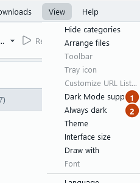
*1 Dark Mode support follows the system; 2 Always dark keeps SDL dark.*

## Themes

**View → Theme** changes SDL's look at once, keeping its layout:

- **Classic**: SDL's own look, the default.
- **Native**: your system's colours. Windows' accent colour (Settings → Personalization →
  Colors) and, when it is on, its contrast theme; the desktop's accent colour and its higher
  contrast setting on Linux (GNOME 47 and later, KDE Plasma); the accent colour on macOS. It
  follows them when you change them.
- **High contrast**: black and white, a bright accent, every edge drawn, text at 7:1 or more.
- **Metro**: Windows 8's flat look: square corners, flat buttons and boxes, a coloured title bar
  with the title centred (on Windows, where SDL draws it), and one-colour icons (Microsoft's
  Fluent UI System Icons).
- **Adwaita**: GNOME's look: round corners, flat grey buttons, a rounded focus ring, GNOME's
  check boxes, a header bar with the title in bold and round buttons (on Windows, where SDL
  draws it), and GNOME's Adwaita icons, in colour for files and categories, one colour in the
  toolbar.
- **Breeze**: KDE Plasma's look: rounded corners, buttons and boxes that take the accent's edge
  under the pointer or when focused, KDE's check boxes and focus frame, KDE's title bar with the
  title centred and round buttons (on Windows, where SDL draws it), and KDE's Breeze icons.
- **Luna**: Windows XP's look: buttons shaded from white with an orange glow under the pointer,
  green ticks, square text boxes, progress in green blocks, a deep blue title bar with the title
  in bold (on Windows, where SDL draws it), and colourful icons drawn for SDL in that manner.
- **Aero**: Windows 7's look: glossy buttons that turn light blue under the pointer, quiet check
  boxes, a glossy green progress bar, a glassy title bar with the title on a soft glow (on
  Windows), and glossy icons drawn for SDL in that manner.
- **Aqua**: Mac OS X's look: gel buttons round at the ends (the default one blue), glossy check
  boxes, a blue focus ring, a blue gel progress bar, a grey title bar with small round buttons
  (on Windows), and icons drawn for SDL in that manner.

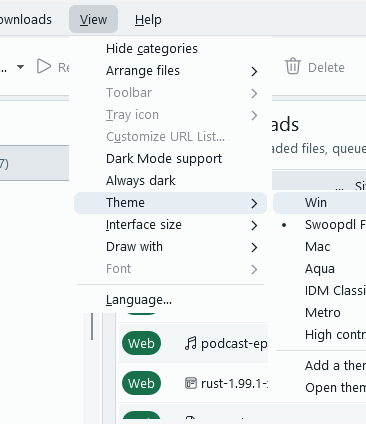
*View → Theme switches at once, keeping the layout.*

<!-- pictures -->

- 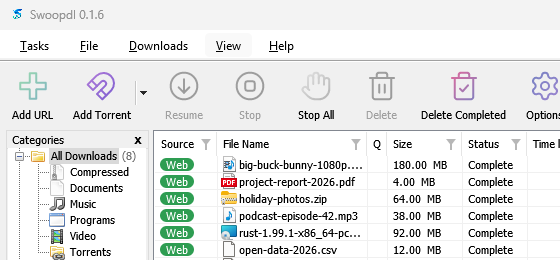
  *Classic*
- 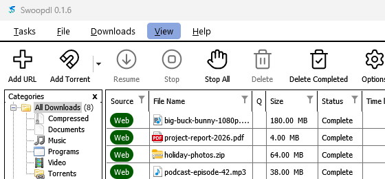
  *High contrast*
- 
  *Adwaita*
- 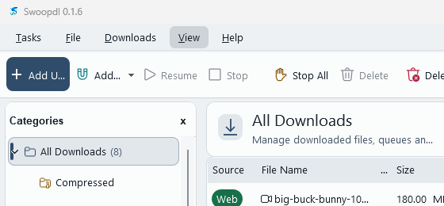
  *Breeze*

Each has a light and a dark side: **Dark Mode support** and **Always dark** choose between
them as before. Theme files you put in the themes folder (**View → Theme → Open themes folder**)
are listed there too, and so are Base16 and pywal colour schemes (**View → Theme → Add a theme
file…**; **pywal** follows `wal` as it runs): [Themes](themes.md) says where that folder is, what
a theme file holds (`inherits`, colours, sizes, control shapes, icons), how a scheme's colours are
used, and how to make and share one.

## The tray icon

Closing the main window doesn't quit SDL. It hides in the notification area, and downloads, queues and schedules carry on. To make closing quit (a portable copy's folder can then be deleted), untick **Options → General → Keep running when closing the window**. If there is no icon for SDL at all — not in the notification area, nor behind the ^ hidden icons — the window minimizes to the taskbar instead, so downloads continue and there is a way back. An icon behind ^ can be clicked to bring the window back, and starting SDL again always does.

On Linux this needs a tray, which most desktops have (KDE Plasma, Xfce, Cinnamon, Ubuntu's GNOME or GNOME with the AppIndicator extension, waybar's tray). On a desktop without one (some tiling window managers), closing the window quits SDL, since there would be nowhere to bring it back from.

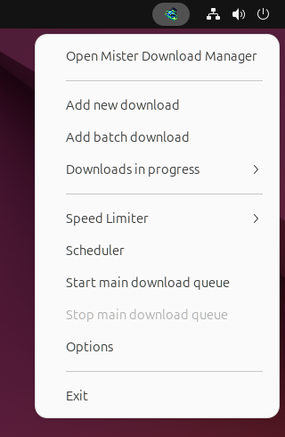
*The tray icon's menu on Ubuntu's GNOME.*

- Click the tray icon to bring the window back.
- Right-click it for **Add new download**, **Add batch download**, **Downloads in progress**, **Speed Limiter**, **Scheduler**, the main download queue, **Options** and **Exit**.
- **Downloads in progress** lists the running downloads. Choose one to see its progress window.

Minimize hides the main window there too, while **Minimize to the notification area** is on in **Options → General**. It is on by default; where the tray has no icon, Minimize sends the window to the taskbar instead.

A download's progress window can go there as well, with its Minimize or with its **Hide to the notification area** button: a short dash with an arrow down to the corner.

On Windows that button is in the window's title bar, left of Minimize, and in the title bar's menu (Alt+Space). On Linux and macOS it's at the end of the tab row.

To bring the window back, choose it in **Downloads in progress**, or double-click the download in the list.

To quit, choose **Tasks → Exit** or **Exit** in the tray menu.

## Where SDL keeps its data

The download list and settings are in `%APPDATA%\swoopdl` (`downloads.json`); on Linux in `~/.local/share/swoopdl`, on a Mac in `~/Library/Application Support/swoopdl`. A portable copy keeps them in its `data` folder instead. Downloaded files go to your **Downloads** folder, sorted into a folder per category; you can change that in **Options → Save to**.

## Next steps

- [Download your first file →](guide-first-download.md)
- [Send browser downloads to SDL →](browser-integration.md)
- [Learn the download list →](download-list.md)
