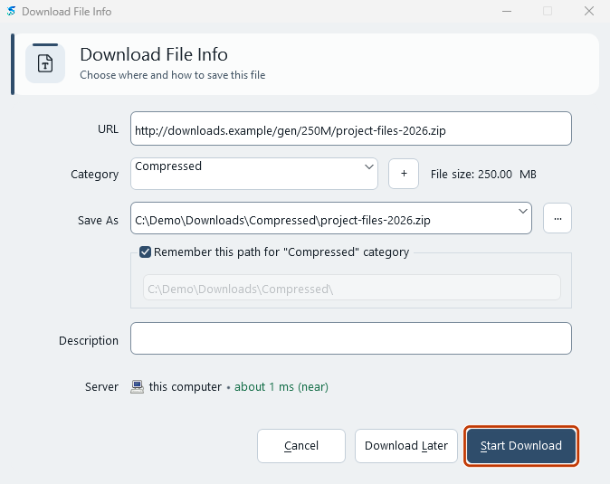
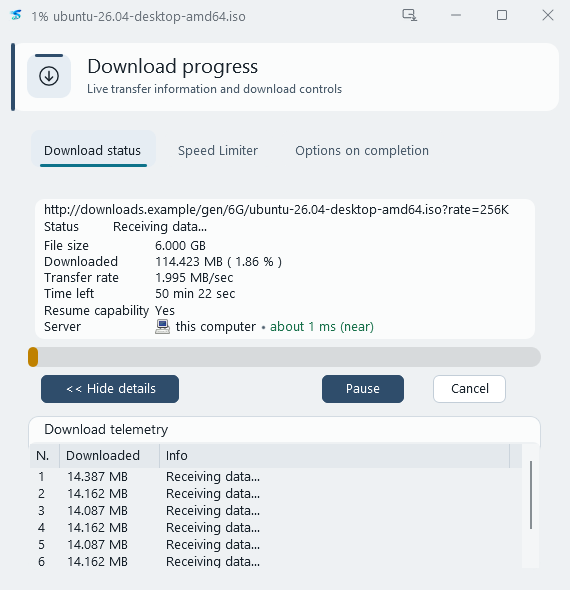
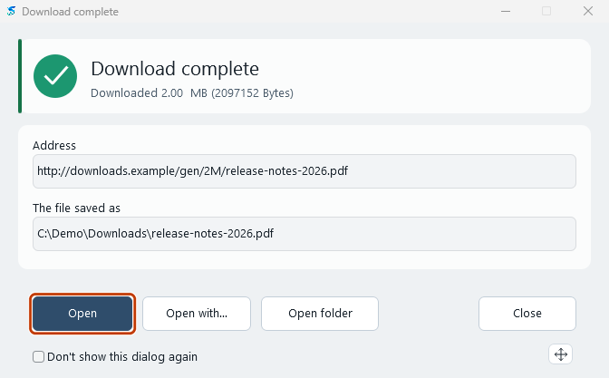
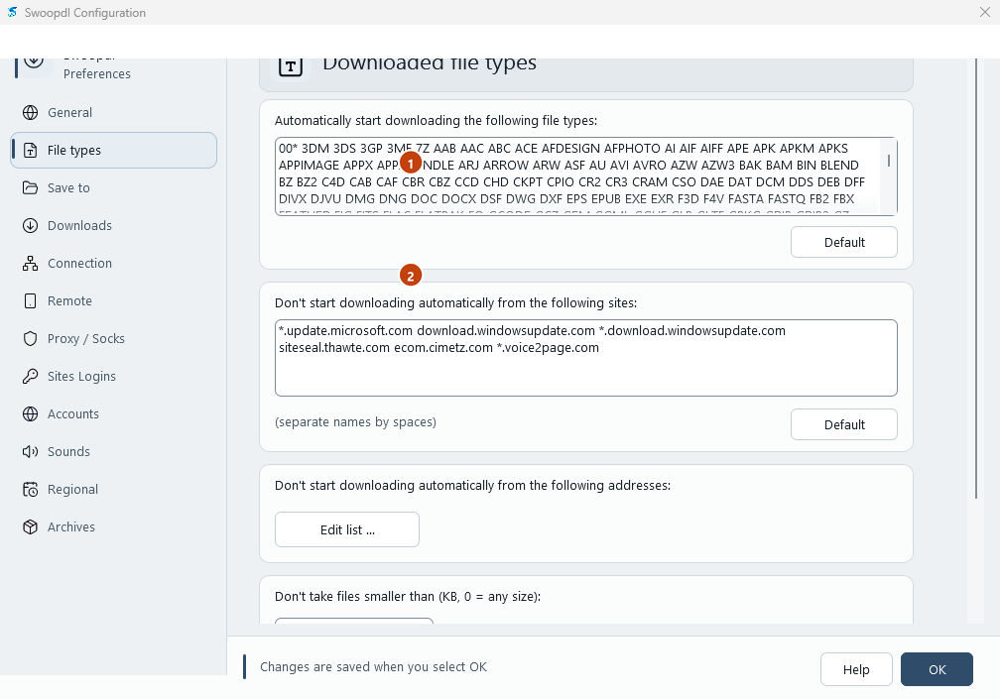

# Tutorial: catch downloads from your browser

[← Back to docs index](README.md)

Set up the bundled extension and enable browser capture to send matching download links to Swoopdl. File-type and site rules still decide which downloads it accepts.

## Before you start

Use the extension files included with your Swoopdl package. No browser-store visit is required.

- **Windows:** select browser integration in the installer, then run its final-page local browser setup option or **Swoopdl Browser Setup** from the Start menu.
- **Linux:** run **Swoopdl Browser Setup** after installing a .deb/.rpm, or run the extracted package's `extension/install-local.sh` helper.
- **macOS:** copy the app to Applications, then run **Set up browser extension.command** from the disk image.

The helper registers native messaging and opens an installed browser. You must still approve the local extension. See [Browser integration](browser-integration.md#set-it-up) for exact paths, AppImage extraction, and portable setup.

Browser capture is off by default. In **Options → General**, enable **Use advanced browser integration** and select your browser before trying the steps below.

Once it is set up, a download link goes like this:

<!-- steps -->

1. 
   *Click a download link in the browser: Download File Info opens in SDL.*
2. 
   *Start Download: the progress window shows it coming in.*
3. 
   *Download complete: Open the file, or Open folder.*

## In Firefox

1. Open `about:debugging#/runtime/this-firefox`.
2. Choose **Load Temporary Add-on** and select the bundled `sdl-firefox.xpi`.
3. Try a download link. If Swoopdl accepts the download, **Download File Info** opens; choose **Start Download**.

The bundled XPI is unsigned. Firefox removes it when the browser closes. A permanent installation in standard Firefox requires a Mozilla-signed XPI; if one is provided, install that local file through `about:addons` instead.

## In Chrome, Edge, Brave, Opera or Vivaldi

1. Open the extensions page, such as `chrome://extensions`, `edge://extensions`, or `brave://extensions`.
2. Enable **Developer mode** and select **Load unpacked**.
3. Select the `chromium` folder printed by the setup helper. On Windows, it is inside the installed application's `extension` folder.
4. Keep **Swoopdl** enabled and try a download link.
5. If Swoopdl accepts it, choose **Start Download** in **Download File Info**.

## Without the store

Local files are the standard installation path for these packages. Keep the application and extension folder in place after setup. Do not load an extension from a browser store belonging to another project.

The setup helper selects a detected browser; you can repeat the manual steps in each additional browser. See [Browser integration](browser-integration.md) for platform paths and native host registration.

## Choose what SDL takes

- **Which file types:** **Options → File types → Automatically start downloading the following file types**. Add or remove types, separated by spaces.
- **Sites to leave alone:** **Options → File types → Don't start downloading automatically from the following sites**. Add the site's name, for example `downloads.example.com` or `*.example.com`.
- **One browser only:** **Options → General → Capture downloads from the following browsers**. Untick the ones SDL should leave alone.

*1 the file types SDL takes, 2 the sites it leaves to the browser.*

Everything SDL doesn't take stays with the browser.

## Download a link the browser would open

Links to a PDF or a video file, which the browser would open itself, go to SDL too when their type is listed. To leave one to the browser, hold **Alt** while clicking it (Firefox opens it; Chrome and Edge download it themselves). Any other link: right-click it and choose **Download with Swoopdl**, which takes any type.

## Next steps

- [Browser integration in detail (Firefox, private windows, what is sent) →](browser-integration.md)
- [If the browser doesn't hand downloads over →](troubleshooting.md#the-browser-doesnt-send-downloads-to-sdl)
- [Download overnight →](guide-download-overnight.md)
