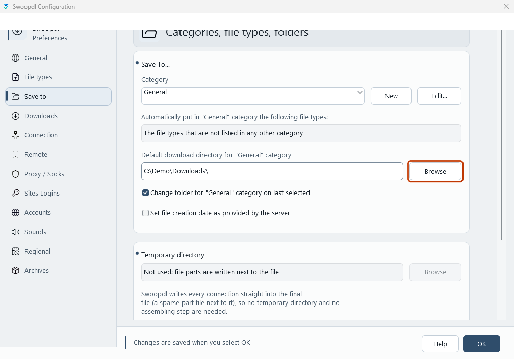

# Tutorial: carry SDL on a USB stick

[← Back to docs index](README.md)

The portable copy runs straight from a USB stick and keeps its list and settings there. With a few settings, it saves your downloads to the stick too.

## 1. Put SDL on the stick

1. Download `Swoopdl-<version>-portable.zip` from the Swoopdl package source provided by its maintainer. Do not use another project's releases.
2. Unzip it onto the stick, for example to `E:\SDL`.
3. Check that there is a `data` folder next to `swoopdl.exe`. That folder is what makes SDL portable. Don't delete it.
4. Run `swoopdl.exe` and pick your language.

## 2. Save downloads to the stick

By default, downloads go to the Downloads folder of the computer you're using. To keep them on the stick:

1. Open **Downloads → Options** and the **Save to** tab.
2. Under **Category**, choose **General**.
3. In **Default download directory for "General" category**, click **Browse** and choose a folder on the stick, for example `E:\Downloads`.
4. Choose the next category (**Compressed**, **Documents**, **Music**, **Programs**, **Video**, **Torrents**) and do the same, for example `E:\Downloads\Video`.
5. Click **OK**.

*Point each category's folder at the stick.*

## 3. Use it

- Add downloads with **Add URL**, the clipboard (**Options → General → Offer to download links copied to the clipboard**) or the drop target (**Tasks → Show drop target**).
- Browser integration is optional: run the bundled `extension\install-local.ps1` helper to register this copy for your Windows account. This writes registry entries and requires a stable folder and drive letter. Skip setup for registry-free use.
- Before you unplug the stick, quit SDL with **Tasks → Exit** so it saves everything. Closing the window only hides it in the tray.

## On another computer

Windows may give the stick another drive letter, such as `F:` instead of `E:`. The folders you set, and the downloads already in the list, still point at the old letter. Check **Options → Save to** and change the folders if needed. When SDL is about to save into a folder that doesn't exist, it asks whether to create it.

## Next steps

- [Portable mode in detail →](portable.md)
- [All the ways to add a download →](adding-downloads.md)
- [Back to the docs index →](README.md)
